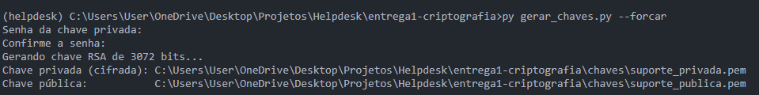
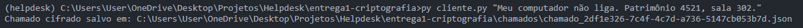
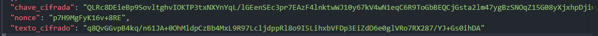
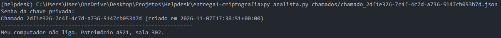
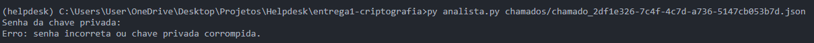
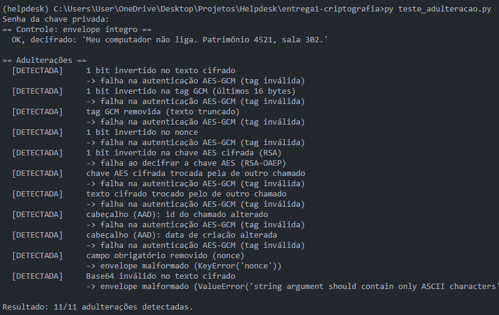

# Entrega 1 — Criptografia assimétrica (Helpdesk Corporativo)

Projeto Integrador: Segurança Aplicada ao Desenvolvimento
Equipe: João Pedro Andrade Oliveira, Erick Silva Vieira, Ivys Gabriel Alves Santos Almeida

## 1. Problema e objetivo

Setores de TI recebem chamados que podem conter credenciais temporárias,
relatórios confidenciais e dados de clientes. Se esse conteúdo trafegar ou for
armazenado sem criptografia, administradores de rede ou atacantes que
interceptem o tráfego podem lê-lo.

**Objetivo:** o cliente cifra o corpo do chamado com a **chave pública** do
suporte, e somente o analista que possui a **chave privada** consegue decifrá-lo.
Qualquer alteração no chamado cifrado deve ser detectada.

## 2. Ambiente e tecnologias

- Python 3 (desenvolvido com Python 3.14)
- Biblioteca [`cryptography`](https://cryptography.io) (única dependência de segurança; nenhum algoritmo foi implementado por conta própria)

## 3. Estrutura da entrega

```
entrega1-criptografia/
├── gerar_chaves.py        # gera o par de chaves RSA do suporte
├── cliente.py             # cifra o chamado (envelope híbrido)
├── analista.py            # decifra o chamado com a chave privada
├── teste_adulteracao.py   # altera o envelope e mostra que a falha é detectada
├── evidencias/            # prints da execução
├── chaves/                # gerada localmente; NÃO vai para o Git
└── chamados/              # envelopes cifrados; NÃO vai para o Git
```

## 4. Como executar

Na raiz do repositório:

```bash
python -m venv venv
venv\Scripts\activate          # Windows
pip install -r requirements.txt
cd entrega1-criptografia
```

1. **Gerar as chaves** (pede uma senha de pelo menos 12 caracteres, que não aparece na tela):
   ```bash
   python gerar_chaves.py
   ```
   Para substituir chaves que já existem, use `--forcar`.
2. **Cifrar um chamado** (usa só a chave pública, não pede senha):
   ```bash
   python cliente.py "Meu computador não liga. Patrimônio 4521, sala 302."
   ```
3. **Decifrar** (pede a senha da chave privada):
   ```bash
   python analista.py chamados\chamado_<id>.json
   ```
4. **Testar adulterações:**
   ```bash
   python teste_adulteracao.py
   ```

> As chaves (`*.pem`) e os chamados cifrados estão no `.gitignore` e nunca
> devem ser enviados ao repositório. Cada integrante gera as suas.

## 5. Algoritmos, parâmetros e justificativa

| Componente | Escolha | Justificativa |
|---|---|---|
| Cifra do texto | **AES-256-GCM** | Cifra simétrica rápida, adequada a textos de qualquer tamanho, e **autenticada** (AEAD): a tag de 16 bytes detecta qualquer alteração. |
| Proteção da chave AES | **RSA-OAEP com SHA-256 e MGF1-SHA-256** | A chave AES é cifrada com a chave pública do suporte. OAEP é o preenchimento recomendado para cifrar com RSA. |
| Par de chaves | **RSA de 3072 bits**, expoente público 65537 | Tamanho recomendado atualmente para uso geral; 65537 é o expoente padrão na prática. |
| Nonce | 96 bits (12 bytes), aleatório, **novo a cada chamado** | Tamanho recomendado para o GCM; nunca é reutilizado com a mesma chave. |
| Chave AES | 256 bits, aleatória, **nova a cada chamado** | Limita o impacto de um eventual vazamento a um único chamado. |
| Dados associados (AAD) | Cabeçalho do envelope (versão, algoritmo, id, data) | O cabeçalho continua legível, mas qualquer mudança nele invalida a tag. |

**Por que cifragem híbrida?** O RSA só consegue cifrar mensagens pequenas e é
lento. Por isso o texto é cifrado com AES, e o RSA protege apenas a chave AES.

## 6. Fluxo de funcionamento

1. O suporte gera o par de chaves e **divulga a chave pública**.
2. O cliente cria uma chave AES e um nonce novos, cifra o chamado com
   AES-256-GCM (usando o cabeçalho como AAD) e cifra a chave AES com a chave
   pública RSA.
3. O cliente grava um **envelope JSON** com: `cabecalho`, `chave_cifrada`,
   `nonce` e `texto_cifrado` (binários em Base64).
4. O analista abre a chave privada com a senha, recupera a chave AES com RSA-OAEP
   e decifra com AES-GCM. Se algo foi alterado, a verificação falha e **nenhum
   texto é exibido**.

## 7. Sigilo e autenticidade

- **Sigilo:** garantido pela cifragem. Quem intercepta o envelope (inclusive
  administradores de rede) não consegue ler o chamado sem a chave privada.
- **Integridade:** garantida pela tag do AES-GCM e pelo AAD. Alterações no texto,
  no nonce, na chave cifrada ou no cabeçalho são detectadas.
- **Autenticidade do remetente: não é garantida por esta solução.** Como a chave
  pública é pública, qualquer pessoa pode criar um chamado válido. Para provar
  *quem* enviou, seria necessário uma **assinatura digital** do solicitante
  (por exemplo, Ed25519 ou RSA-PSS), que não faz parte desta entrega.

## 8. Certificados digitais e PKI (conceitual)

Nesta entrega, o cliente simplesmente **confia** na chave pública que recebeu.
Em um ambiente real, essa confiança vem de uma **PKI**: uma autoridade
certificadora (AC) assina um **certificado digital** que vincula a chave pública
ao suporte. O cliente valida a cadeia do certificado e sua validade antes de
cifrar, o que impede que um atacante substitua a chave pública pela dele
(ataque do homem no meio). Essa validação não foi implementada aqui.

## 9. Gestão de chaves

- A chave privada é salva em **PEM/PKCS#8 cifrada com senha**
  (`BestAvailableEncryption`). Se o arquivo for roubado, não é utilizável sem a senha.
- Senha mínima de 12 caracteres, solicitada no terminal sem eco.
- `gerar_chaves.py` não sobrescreve chaves existentes sem `--forcar`.
- `*.pem` e `chaves/` estão no `.gitignore`, para evitar o envio acidental ao GitHub.
- Em produção, a chave privada ficaria em um cofre ou HSM, com controle de acesso
  e rotação periódica.

## 10. Testes e evidências

`teste_adulteracao.py` cria um chamado legítimo, confirma que ele decifra e aplica
**11 adulterações**, uma por vez. Todas foram detectadas (**11/11**).

| # | Evidência | Arquivo |
|---|---|---|
| 1 | Geração das chaves RSA-3072 | `evidencias/1-gerando-chave.png` |
| 2 | Cliente cifrando o chamado | `evidencias/2-chamado-cliente.png` |
| 2b | Envelope cifrado (conteúdo ilegível) | `evidencias/2b-envelope-cifrado.png` |
| 3 | Analista decifrando com a senha correta | `evidencias/3-analista-decifra.png` |
| 4 | Senha incorreta é rejeitada | `evidencias/4-senha-errada.png` |
| 5 | Teste de adulteração: 11/11 detectadas | `evidencias/5-teste-adulteracao.png` |








## 11. Riscos, limitações e melhorias

**Limitações**
- Sem PKI: o cliente confia na chave pública recebida (risco de substituição da chave).
- Sem autenticação do remetente (qualquer um com a chave pública cria chamados).
- Sem proteção contra **replay**: um envelope válido pode ser reenviado e será aceito de novo.
- A segurança da chave privada depende da força da senha e do cuidado com o arquivo.
- Os envelopes são gravados em arquivos locais; não há servidor, transporte nem controle de acesso.
- Não há rotação de chaves nem revogação.

**Melhorias possíveis**
- Assinatura digital do solicitante (Ed25519) para autenticar a origem.
- Certificado digital e validação da cadeia (PKI).
- Registro de ids já processados para barrar replay.
- Armazenar a chave privada em um cofre/HSM e rotacioná-la periodicamente.
- Transporte protegido por TLS, somando-se à cifragem do conteúdo.

## 12. Referências

- Documentação da biblioteca `cryptography`: https://cryptography.io
- NIST SP 800-38D — Recomendação para o modo GCM.
- RFC 8017 — PKCS #1 v2.2 (RSA e OAEP).
- NIST SP 800-57 — Recomendações para gestão de chaves.
